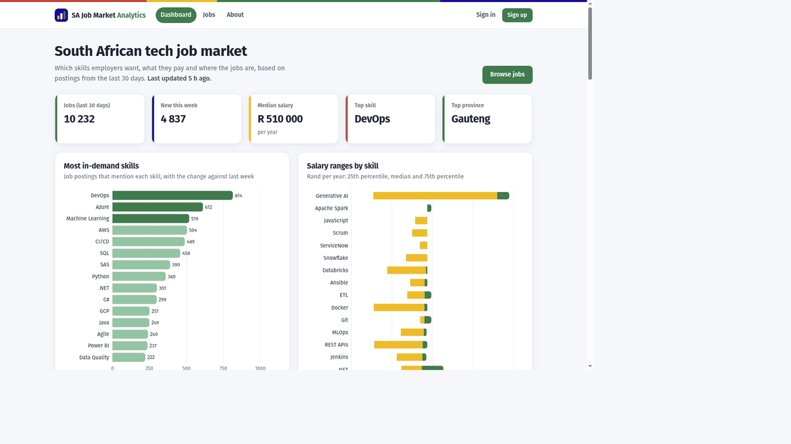
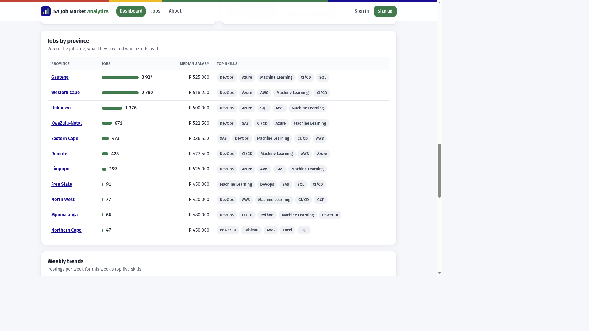
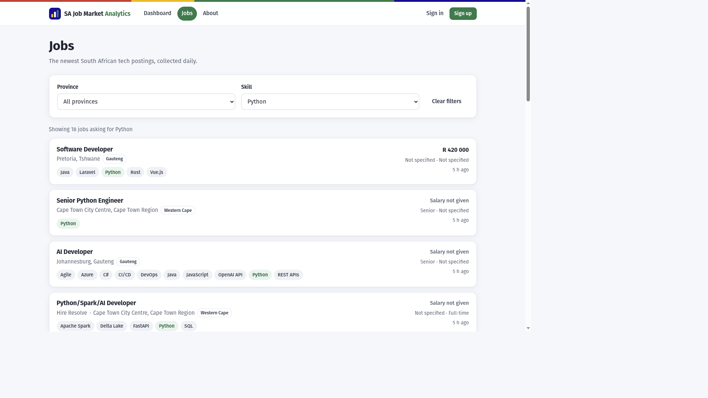
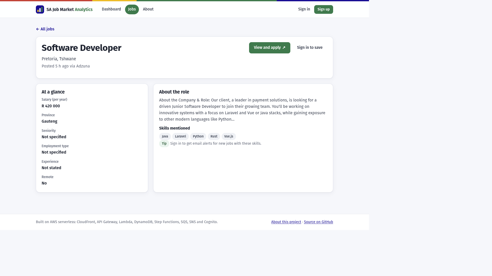
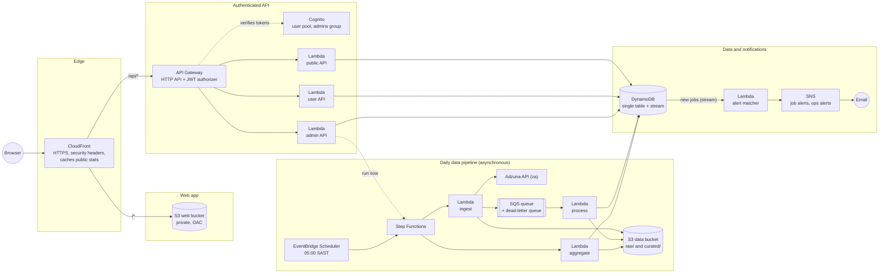
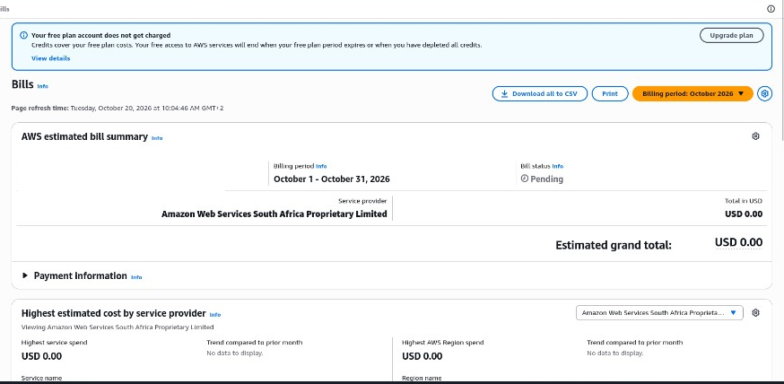

# SA Job Market Cloud Analytics Platform

[](https://github.com/Sbusiso-tech/sa-job-market-cloud-analytics/actions/workflows/ci.yml)


A serverless AWS platform that tracks which tech skills South African employers are hiring for, what they pay
(in rands) and where (by province). It collects job postings every day, analyses them, and serves the results
through a secure web app. Signed-in users can save jobs and get email alerts for new jobs that match their skills.

**Live app:** https://dzc3ibsjqeo54.cloudfront.net

Built as the capstone for the WeThinkCode_ Cloud Computing (AWS) programme, and designed to **cost nothing to
run**: every service stays inside the AWS free allowances ([cost report](docs/cost.md)).

## Why

Job seekers and students in South Africa have to guess which skills are worth learning. Job boards list postings,
but don't answer "which skills are most in demand in Gauteng right now, and what do they pay?". This platform
answers that from real, daily data: top skills and how they change week to week, salary ranges per skill in rands,
demand per province, and common skill combinations.

## Features

- **Dashboard:** headline numbers, top 30 skills with weekly change, salary ranges (p25 / median / p75) per skill,
  jobs and top skills per province, common skill pairs, seniority and employment-type breakdowns, 12-week trends.
- **Jobs:** the latest jobs, filterable by province and skill, with pagination and job details.
- **Accounts:** sign-up and sign-in with Amazon Cognito; save jobs; delete your account and all your data.
- **Email alerts:** subscribe to a skill (and optionally a province) and get a digest of matching new jobs.
- **Admin:** run the pipeline on demand and see the history of runs.
- **Daily pipeline:** collects up to 40 pages of South African tech jobs from the Adzuna API every morning, cleans
  them, extracts skills, converts salaries to rand per year and maps each job to one of the 9 provinces.

## Screenshots

The live dashboard, 20 October 2026: 10,232 postings in the last 30 days, a median salary of R510,000 and DevOps
as the most requested skill.










## Architecture



**How a day's data flows.** At 05:00 EventBridge Scheduler starts the Step Functions workflow. The ingest Lambda
calls the Adzuna API (at most 40 calls), saves the raw response to S3 and puts one message per job on an SQS queue.
The process Lambda enriches each job and stores new ones in DynamoDB. The workflow waits until every queued job is
processed, then the aggregate Lambda computes all statistics into small DynamoDB items and clears the CloudFront
cache for public data. New jobs flow through the DynamoDB stream to the alert matcher, which emails each matching
user one digest through SNS.

**Key design decisions**

- **API behind CloudFront at `/api/*`.** The site and API share one origin, so there's no CORS, and public statistics
  are cached at the edge. Personal and admin routes are never cached.
- **Precomputed statistics.** Each dashboard request is one cheap DynamoDB read, so no query engine (and no Athena
  or Glue cost) is needed.
- **SQS between ingest and processing.** It spreads writes out so the free provisioned DynamoDB capacity is enough,
  and failed jobs go to a dead-letter queue instead of being lost.
- **Single-table DynamoDB.** Jobs, statistics, saved jobs, alerts and pipeline runs share one table with two
  indexes (jobs by province, all jobs newest first).
- **No runtime dependencies.** The Lambdas use only the Python standard library and `boto3`, so there are no layers
  or container images.

The full design is in [PLAN.md](PLAN.md), and every API route is specified in
[docs/api-contract.md](docs/api-contract.md).

## Capstone deliverables

| Deliverable | How it is met |
|---|---|
| Authenticated backend API: **API Gateway** | HTTP API under `/api/*` with a Cognito JWT authorizer and throttling (10 requests/s, burst 20) |
| Authenticated backend API: **Lambda** | 8 Python 3.12 (arm64) functions: public, user and admin APIs; ingest, process, aggregate, pipeline status, alert matcher |
| Authenticated backend API: **DynamoDB** | Single-table design with two global secondary indexes, a stream and TTL |
| Authenticated backend API: **Cognito** | User pool with email sign-up, verified email, strong passwords and an `admins` group |
| **Infrastructure as Code** | Everything is in AWS SAM ([`infra/template.yaml`](infra/template.yaml)); `make deploy` creates it and `make destroy` removes it |
| **Web app on S3 + CloudFront** | React app in a private S3 bucket, served only through CloudFront with Origin Access Control |
| **Asynchronous services** | EventBridge Scheduler → Step Functions → SQS (with dead-letter queue) → Lambda; DynamoDB Streams → alert matcher |
| **Notifications** | SNS email digests to users for matching jobs; CloudWatch alarms email the admin about failures |
| **Secure access control** | User and admin roles, one least-privilege IAM role per function, private encrypted S3, secrets in SSM Parameter Store, HTTPS only, CSP and HSTS headers |
| **CI/CD** (extra) | GitHub Actions: lint, tests and build on every pull request; automatic deploy from `main` using OIDC, with no stored AWS keys |

## Security

- **Users only see their own data.** The user id always comes from the verified Cognito token, never from the
  request, and tests check it.
- **Least privilege.** Each Lambda has its own IAM role limited to the exact actions and resources it needs.
- **No public storage.** Both S3 buckets block public access and require TLS; the web bucket is readable only
  by CloudFront.
- **Secrets.** The Adzuna API keys live only in SSM Parameter Store (SecureString) and are never logged.
- **Headers.** A strict Content Security Policy, HSTS and frame protection on every page.
- **CI without keys.** GitHub Actions signs in with short-lived OIDC tokens. Only this repository's `main` branch
  can deploy, and the deployment role can only manage this project's stack
  ([`infra/bootstrap/github-oidc.yaml`](infra/bootstrap/github-oidc.yaml)).
- **Privacy (POPIA).** Only a user's email and Cognito id are stored; deleting an account removes all their data
  and their email subscription.

## Tech stack

| Area | Technology |
|---|---|
| Compute and API | AWS Lambda (Python 3.12, arm64), API Gateway HTTP API |
| Data | DynamoDB (single table, streams, TTL), S3 |
| Messaging and orchestration | SQS, SNS, Step Functions, EventBridge Scheduler |
| Auth | Amazon Cognito (SRP sign-in, JWT authorizer) |
| Edge | CloudFront (Origin Access Control, cache policies, CloudFront Functions) |
| Operations | CloudWatch alarms and logs, AWS Budgets, SSM Parameter Store |
| Infrastructure as Code | AWS SAM / CloudFormation |
| Web app | React, TypeScript, Vite, Recharts, `amazon-cognito-identity-js` |
| Testing | pytest + moto (backend), Vitest + Testing Library (web app), cfn-lint |
| CI/CD | GitHub Actions with OIDC |
| Data source | [Adzuna](https://developer.adzuna.com/) South Africa job search API |

## Quality

- **350 automated tests:** 303 backend tests at 99% coverage (AWS mocked with moto, including an API contract
  test), and 47 web app tests.
- **Linting:** ruff (Python), eslint and TypeScript type checks (web app), cfn-lint (both CloudFormation templates).
- **CI:** all of the above, plus a SAM build, on every pull request and push to `main`.

## Run it locally (no AWS account needed)

Requirements: Python 3.12, Node.js 20 or newer, `make`. On Windows, use WSL2.

```bash
git clone https://github.com/Sbusiso-tech/sa-job-market-cloud-analytics.git
cd sa-job-market-cloud-analytics

make venv          # backend virtual environment with test tools
make test          # backend tests with coverage
make demo          # runs the data pipeline offline on bundled sample data

make frontend-install
npm --prefix frontend run dev   # web app at http://localhost:5173 in mock mode (sample data)
```

## Deploy to your own AWS account

Requirements: an AWS account (the Free plan works), the AWS CLI v2 and the AWS SAM CLI, with a CLI profile named
`sa-jobmarket` in `eu-west-1` (or pass `AWS_PROFILE=...`).

```bash
# 1. Optional: Adzuna API keys (free at developer.adzuna.com), stored in SSM Parameter Store
read -rsp "Adzuna app id: " ADZUNA_APP_ID; echo
read -rsp "Adzuna app key: " ADZUNA_APP_KEY; echo
make seed-secrets ADZUNA_APP_ID="$ADZUNA_APP_ID" ADZUNA_APP_KEY="$ADZUNA_APP_KEY"

# 2. Backend and web app
make deploy ADMIN_EMAIL=you@example.com
make frontend-install frontend-build frontend-deploy
make outputs                     # shows the web app URL

# 3. Load data
make run-pipeline SAMPLE=1       # bundled sample data, or omit SAMPLE=1 for real Adzuna data
```

Confirm the AWS Notification email so you receive alarms. Without Adzuna keys, add `SCHEDULE_ENABLED=false` to
`make deploy`. `make destroy` removes everything. Run `make help` for every command.

For automatic deploys from GitHub, run `make bootstrap-oidc` once, then add the repository secrets
`AWS_DEPLOY_ROLE_ARN`, `CFN_ROLE_ARN` (both from the bootstrap stack outputs) and `ADMIN_EMAIL`.

## Cost

Running cost is **$0.00 a month**. All services stay inside the AWS always-free allowances (or the 12-month free
tier for API Gateway and S3), with a zero-spend budget and a $1 budget as guardrails. The October 2026 bill is
USD 0.00, and measured usage against each free limit is in [docs/cost.md](docs/cost.md).



## Repository layout

```
backend/src/sajobs/     core library: Adzuna client, cleaning, skills, salaries, provinces, statistics, DynamoDB access
backend/src/handlers/   Lambda handlers: ingest, process, aggregate, pipeline status, alert matcher, APIs
backend/tests/          pytest + moto tests
frontend/src/           React web app (pages, API client, Cognito auth, mock mode)
infra/template.yaml     the whole AWS stack (SAM)
infra/statemachine/     Step Functions workflow
infra/bootstrap/        one-time GitHub OIDC deployment roles
docs/                   API contract, cost report, demo script, retrospective
.github/workflows/      CI/CD
```

## Demo and lessons

The 12-minute walkthrough is in [docs/demo-script.md](docs/demo-script.md). The bugs that showed up on the
real account, and what changed because of them, are in [docs/retrospective.md](docs/retrospective.md).

## Author

**Sbusiso Shinga**, WeThinkCode_ Cloud Computing (AWS), 2026.

WTC-AKUZ89DZ
